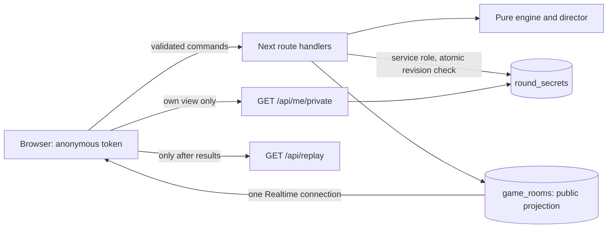
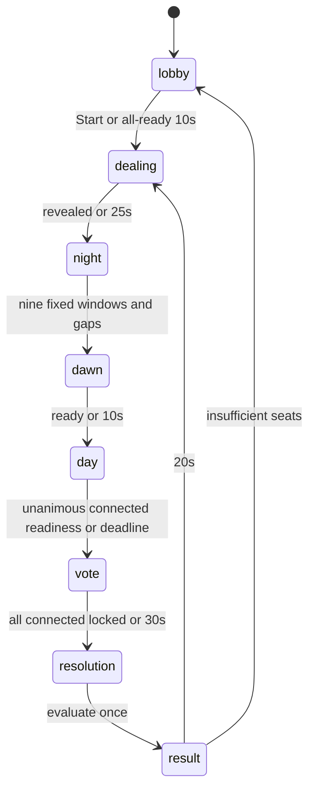

# Architecture

The modern runtime uses the deterministic `engine/` package. It imports only rules data and engine types: no React, network, database, clock or random-device calls. Seeded shuffles and explicit timestamps make simulations reproducible. The old route contract remains available for existing rooms during migration; the new client uses `/api/session`, `/api/advance` and `/api/me/private`.

## Read boundaries and models

JSON schemas under `schemas/` describe transport models. `lib/session-types.ts` contains matching TypeScript types. Every property in the schemas has a visibility description.

| Model | Readers and contents |
|---|---|
| GameState | Everyone: phase/step/deadlines; names and cosmetics; public settings/deck multiset; anonymous progress counts; voluntary claims/chat; public result only after resolution. |
| PlayerPublic | Everyone: identity, name, appearance, connection and spectator status; ready only in lobby; no token or role. |
| PlayerPrivate | Only that token's seat: original card after reveal; copied role; own action, own report and vote; own undo deadline. |
| RoleAction | Acting player and server only; discriminated by role and validated for phase, target, copy and window. |
| RoundSecrets | Server only: original/current cards, copied marker, actions, ballots, reports and replay events. |
| GameEvent | Server until Results; then authenticated room members may fetch a completed replay. No token or token hash is recorded in it. |
| RoomSettings | Public; only the host edits them in lobby. Client sound/display/accessibility preferences remain local. |

`round_secrets` and `game_players` deny anonymous/authenticated reads and are never published. Only `game_rooms` is in the new publication. `commit_session` compares private revisions, stores one bounded JSON document and updates the public row only when its public content changes. Private revision changes are not broadcast. Night has fixed windows even when roles are absent, no per-seat readiness, no action receipts or role-dependent public animation. Private action responses have a common minimum 125ms latency and shape. Public deck differences are intentional; night timing comparisons normalize that already-public multiset and room identities.

Anonymous tokens have 256 bits of browser-generated randomness, live in localStorage and accompany authenticated requests. Only their SHA-256 hashes are stored. All requests validate origin, phase, actor, round and targets; receipts make retries idempotent. A changed-only movement channel carries quantized cosmetic coordinates, never cards or game decisions. Local development substitutes authenticated server-sent public events for cloud Realtime.

No persistent Vercel process is required. Clients schedule a single wake-up at the server deadline; any client may ask `/api/advance`, which recomputes eligibility on the server. Local development also schedules one-shot server deadlines. Realtime Presence detects connection loss; sparse write-only liveness keeps the director authoritative. Supabase pg_cron deletes sessions and player rows after 24 hours. Replay history retains at most three completed rounds per room; each log targets under 8KB.

## Alternatives considered

Colyseus and Socket.io require persistent server processes and socket hosting beyond this Vercel model. LiveKit adds media infrastructure that this Discord-based game does not need. Supabase supplies shared Postgres transactions and managed Realtime within the verified free-plan budget, while route handlers keep secrets off every client. Provider limits and the modeled ten-player traffic budget are in BUDGET.md.

The tabletop upgrade adds `publicSequence` to the public projection. Its server-only digest is calculated from public fields, so private actions and receipts do not advance the sequence. Own private replies also include public phase/window context and are ordered by revision and server timestamp. Client generations reject replies after leaving or being removed. See `TABLETOP_POLISH.md`.
